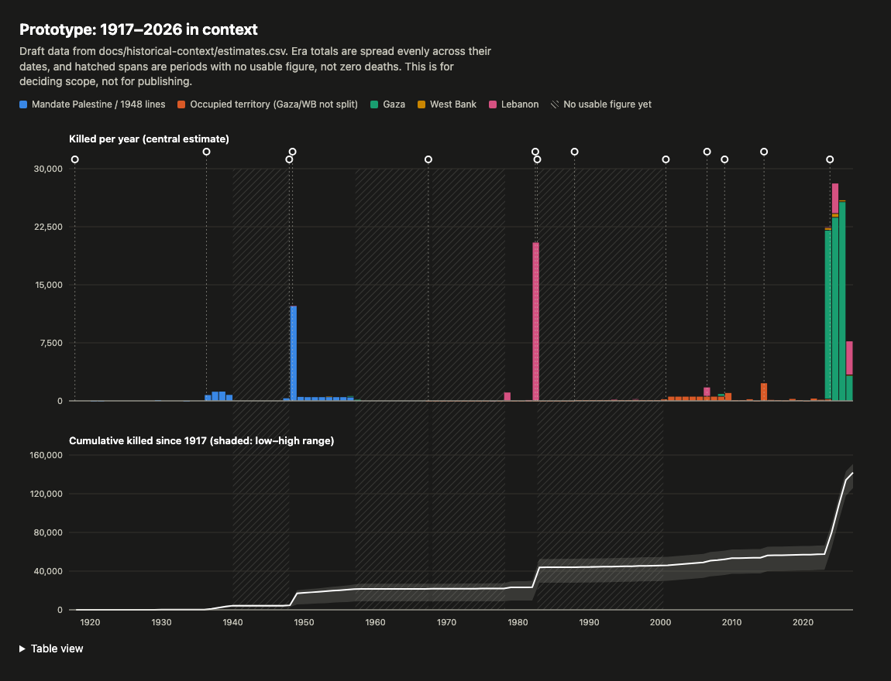

# Research: a zoomed-out time series, from the British Mandate to now

Status: **research spike, for deciding whether to commit**. Nothing here is wired into the site.

Files in this folder:

| File | What it is |
|---|---|
| `README.md` | This write-up: sources, gaps, proposed shape, recommendation |
| `estimates.csv` | Draft era-level estimates (low / central / high) with source, cadence and confidence per row |
| `events.json` | Draft zoomed-out event list (39 events, tiered) |
| `prototype-chart.ts` | Throwaway generator: `bun docs/historical-context/prototype-chart.ts` |
| `prototype.html` / `prototype.png` | Its output: annual bars by region + cumulative line, gaps hatched, tier-1 events. Also written to `site/static/prototypes/historical-context/index.html`, so branch previews serve it at `/prototypes/historical-context/` |



## TL;DR

- **It's feasible, but only as an annual, estimate-with-ranges series, not as a daily one.** Daily cadence exists only from **29 Sep 2000** (B'Tselem's per-person database), with OCHA's database as a second source from 2008. Before that, the best we get is annual figures (1936–39 and 1987–2000), era totals (the Nakba, 1949–56, the 1982 invasion of Lebanon) and event counts (riots and massacres). There are several multi-year stretches with **no usable figure at all**.
- **The draft puts documented killings from 1920 to 6 Oct 2023 at about 58,000 (range 42,000–67,000)**: about 34,600 Palestinians in Palestine and about 23,200 people in Lebanon. **Since 7 Oct 2023 our own datasets add about 84,000** (Gaza 74,540, West Bank 1,124, Lebanon 8,433, as of 24 Oct 2026). That is more than the whole documented century before it, even against the high-end estimate. That comparison is the main thing a zoomed-out view would show. It's also the claim most likely to be contested, so the gaps have to be shown on the chart, not hidden.
- **Recommendation: commit, with a limited scope.** Ship v1 as an **annual** zoomed-out view (1917 to now) built from a new hand-curated `historical_killed` dataset with low/central/high values and per-row citations. Show gaps as hatched spans and keep injuries out. Make the 2000-to-now stretch the first upgrade to real daily data (B'Tselem + OCHA), so the zoom from the current chart into history is continuous for its last 23 years. The main cost is research, not engineering: about 2–4 weeks of sourcing work to move the "low" and "medium" rows to primary sources, against about 3–5 days of engineering.

## Scope decisions (made without you; see Assumptions)

1. **Who is counted:** Palestinians killed by British Mandate forces, Zionist militias, Israeli forces or Israeli settlers/civilians, plus **everyone killed in Lebanon by Israeli action**. This mirrors the existing Lebanon dataset, which counts all MoPH-reported deaths, not only Palestinians. Deaths of Palestinians at the hands of Arab states (e.g. Jordan in 1970) and intra-Palestinian killings are **excluded**.
2. **Combatants are included**, as they are in the current daily data (MoH does not separate them). The rows note where a figure is mostly combatants, e.g. the 1982 Lebanese police count and Morris's "infiltrators".
3. **Edge cases that are flagged, not excluded:** Sabra and Shatila (carried out by the Phalange inside an IDF cordon) and the 1920/1921/1929 riots (Arabs killed mostly by British forces, some by Jewish residents).
4. **Regions:** before 1967 there's no Gaza/West Bank split for most of the data, so the series uses `palestine` (Mandate Palestine and the 1948 lines), `opt` (occupied territory where sources don't split Gaza and the West Bank), `gaza`, `west_bank` and `lebanon`. `opt` is a temporary bucket: B'Tselem and OCHA both split by region, so it should disappear once those sources are ingested properly.
5. **Killed only.** Injury figures exist for a few eras (1936–39: 14,760; 1982: 30,302; 2006: 4,409) and after 2000. Before that the gaps are too large to plot honestly.

## Source inventory by era

Confidence: **high** = primary or name-based count; **medium** = credible secondary or official aggregate; **low** = single or unverified figure, needs primary sourcing.

| Era | Interval | Best source(s) | Central (range) | Cadence available | Conf. |
|---|---|---|---|---|---|
| Early Mandate riots | 1920, 1921, 1929, 1933 | British commissions of inquiry (Palin, Haycraft, Shaw, Murison) | 4 / 48 / 116 / 26 | event | high/med ✓ |
| Great Revolt | Apr 1936 – Aug 1939 | W. Khalidi's analysis of British figures; Colonial Office annual reports | 3,832 (2,108–5,000) | **annual** (reports exist; not yet extracted) | medium |
| Irgun bombings | 1937–39 | itemised list of 32 attacks, each cited (Wikipedia *List of Irgun attacks*) | 273 (273–350) | event | medium ✓ |
| WWII and after | 1940 – Nov 1947 | none found | **gap** | — | — |
| Civil-war phase | 30 Nov 1947 – 14 May 1948 | UK delegation to UN (1,300 Arabs killed to 24 Apr 1948) | 2,000 (1,300–3,000) | partial **monthly** (British returns) | medium |
| Nakba war phase | 15 May 1948 – Jan 1949 | Aref al-Aref, *al-Nakba* (13,000 for 1947–49); PCBS (~15,000); Morris (lower) | 11,000 (1,700–12,000) | era total; massacres individually | low |
| Border killings | Jul 1949 – Oct 1956 | B. Morris, *Israel's Border Wars* | 3,850 (2,700–5,000) | era total | medium |
| Qibya, Kafr Qasim | 1953, 1956 | UN MAC; Israeli court records | 69; 49 | event | high |
| Gaza occupation | Nov 1956 – Mar 1957 | UNRWA (Khan Yunis 275); Rafah 111 | 386 (386–1,200) | event | low |
| Between wars + 1967 war | Mar 1957 – Jun 1967 | none found | **gap** | — | — |
| Occupation pre-intifada | Jun 1967 – Dec 1987 | **could not verify** ~650; only partial Israeli government counts (MERIP 1988) | 650 (114–1,000) | era total | low ✗ |
| First Intifada → Oslo | 9 Dec 1987 – 28 Sep 2000 | B'Tselem (1,376 by forces + 115 by civilians) | 1,491 | **annual, region split; per-person lists** | high |
| Second Intifada → 2008 | 29 Sep 2000 – 26 Dec 2008 | B'Tselem database | 4,907 | **daily** (per person) | high |
| Cast Lead → Sep 2023 | 27 Dec 2008 – 30 Sep 2023 | OCHA casualties DB (+ B'Tselem) | ~6,400 | **daily/per-incident** | high ✓* |
| **Lebanon** Hula | Oct 1948 | — | 35 (35–58) | event | medium |
| Lebanon raids | 1968 – Mar 1978 | none found | **gap** | — | — |
| Litani invasion | Mar 1978 | Lebanese govt; various | 1,100 (700–2,000) | era | medium |
| Beirut strikes | Jul 1981 | Palestinian reports (123); Lebanese police (~90, Beirut only); Lebanon at UN (300+) | 123 (90–300) | event | medium ✓ |
| 1982 invasion | 4 Jun – 31 Aug 1982 | Lebanese police via *an-Nahar* | 19,085 (17,825–19,085) | periodic police tallies (weekly-ish via press?) | medium |
| Sabra and Shatila | 16–18 Sep 1982 | al-Hout (name-based); Kahan Commission | 1,390 (460–3,500) | event | medium |
| South Lebanon occupation | Sep 1982 – May 2000 | only Accountability (1993, 118) and Grapes of Wrath (1996, 154) | partial **gap** | event | med/high |
| 2006 war | 12 Jul – 14 Aug 2006 | Lebanese govt / Higher Relief Council; HRW (1,109) | 1,191 | **daily** (HRC sitreps on ReliefWeb) | high |
| Lebanon 2006–2023 | | low-level; not compiled | small **gap** | — | — |
| **Existing datasets** | 7 Oct 2023 → now | this repo | 83,949 | daily | — |

\* The OCHA yearly figures were checked against a per-year sheet built from OCHA's data (C. Bjork-James, CC BY 4.0; 2008–Sep 2023 total 6,412). It's a secondary copy, so do a final check against OCHA's own dashboard before publishing. 1–6 Oct 2023 isn't covered yet (a handful of West Bank deaths).

✓ = checked in the verification pass below; ✗ = checked and could not be confirmed.

### Cadence and interval gaps at a glance

```
1917 ─ 1936 │ events only (riots)
1936 ─ 1939 │ ANNUAL possible (Colonial Office); currently era total
1940 ─ 1947 │ ░░░░ GAP
1947 ─ 1949 │ partial monthly → era total (largest single uncertainty: 1,700–12,000 for the war phase)
1949 ─ 1956 │ era total (Morris range)
1956 ─ 1957 │ events
1957 ─ 1967 │ ░░░░ GAP (incl. the 1967 war itself)
1967 ─ 1987 │ era total, weak
1987 ─ 2000 │ ANNUAL, region split (B'Tselem); per-person → daily with scraping effort
2000 ─ 2023 │ DAILY (B'Tselem per-person; OCHA from 2008)
2023 ─ now  │ DAILY (this repo)

Lebanon
1948        │ event
1968 ─ 1978 │ ░░░░ GAP
1978 ─ 1982 │ events / era totals
1982 ─ 2000 │ ░░░░ mostly GAP (two operations counted)
2006        │ DAILY (34 days)
2006 ─ 2023 │ ░ small GAP
2023 ─ now  │ daily-ish (this repo)
```

The gaps that matter most for the chart's shape:

1. **1948 war phase.** The range is 1,700–12,000. Everything before 1967 rides on this one number, and it's where critics will push. The central uses al-Aref's 13,000 (Palestinian, contemporaneous, the most-cited Palestinian count) minus the civil-war phase.
2. **1957–1967, including the 1967 war.** No usable Palestinian-specific figure was found. This needs dedicated research (UNRWA reports, PLA losses, Palestinian civilians in the West Bank and Gaza during the war).
3. **Lebanon 1968–1978 and 1982–2000.** Israeli strikes went on for decades, but outside a few named operations they haven't been compiled. One aggregate claims ~33,600 Lebanese civilians killed from 1968–2000. It's unsourced, and it would be much higher than the ~22,000 we can itemise, which is itself a sign of the gap.
4. **1967–1987.** ~650 is a thin single figure. Better candidates are UN Special Committee reports and Al-Haq.

### Top-down cross-check

PCBS's Nakba-day releases give a "Palestinian and Arab martyrs since 1948, inside and outside Palestine" total: about **100,000** (May 2023), **134,000** (May 2024) and **154,000** (May 2025). The pre-Oct 2023 PCBS figure (~100k) is well above our bottom-up ~58k because PCBS also counts **Arab state soldiers** (1948, 1956, 1967, 1973), Palestinians killed abroad (Jordan, Tunisia and elsewhere), and probably the Lebanon gaps above. We should **cite PCBS as a ceiling and context**, not plot it: it has no time breakdown and its inclusion rules aren't published. Their May 2023 → May 2025 jump (+54k) is consistent with our post-Oct 7 totals over the same window.

## Proposed shape, if we commit

### Data: a new hand-curated dataset, not an extension of the daily ones

Extending `casualties_daily.json` backwards would force fake daily rows for 1948. Instead, add a new `historical_killed` dataset (API `v3`) that grows `estimates.csv` into:

```ts
type HistoricalKilledEra = {
  id: string;               // "nakba-war-1948"
  start: string; end: string; // YYYY-MM-DD, inclusive
  region: "palestine" | "gaza" | "west_bank" | "opt" | "lebanon";
  killed: { low: number; central: number; high: number };
  injured?: number;
  cadence: "event" | "annual" | "monthly" | "daily" | "era";
  confidence: "high" | "medium" | "low";
  sources: Array<{ title: string; url?: string; page?: string }>;
  notes?: string;
  // optional finer breakdown when the source has it (e.g. 1936–39 per year)
  periods?: Array<{ start: string; end: string; killed: number }>;
};
```

- Era rows **stop at 6 Oct 2023**. From then on the zoomed-out view takes per-year sums from the existing daily datasets, as the prototype does, so there's one source of truth.
- The 2000–2023 rows should be **generated** from B'Tselem per-person data, plus OCHA for cross-checks, rather than hand-typed. That gives a real daily series for that stretch and a Gaza/West Bank split, and removes the `opt` bucket. Check B'Tselem's terms before redistributing (a public Kaggle scrape exists, covering Oct 2000 – Sep 2023, but we should get the data from B'Tselem itself or ask them). OCHA's raw database needs an account (email ochaopt@un.org); the public dashboard has no CSV export.
- Put sources in Google Sheets like the other datasets, so non-engineers can edit citations, and keep the CSV in the repo as the reviewed snapshot.

### Chart: zoom out, don't replace

- **Zoomed-out view = annual stacked bars by region + a cumulative panel with a low–high band**, one shared x-axis, two panels, never a dual axis. The prototype uses this layout. The bars show *when*; the cumulative panel shows *how much the last three years weigh against the century*.
- **Transition:** the current daily chart is the 2023–now part of this axis. A "Zoom out" control animates the x-domain from Oct 2023–now out to 1917–now. Below about a 5-year span, render daily (2000+); above it, aggregate to years. Before 2000 there's no zoom-in deeper than years, so that part of the chart should look different: muted, with no daily scrub.
- **Gaps are drawn, not left blank:** hatched spans with a tooltip saying what's missing. Ranges are visible in the cumulative band and the bar tooltips ("up to N").
- **Uniform spreading is a stopgap.** The prototype spreads era totals evenly across their dates, so the 1936–39 revolt and the first intifada look flatter than they were. Getting the Colonial Office annual figures and B'Tselem's annual table fixes the two worst cases.
- **Mobile:** 110 annual bars at ~3px each still read. Show tier-1 events only.

### Events: a separate, tiered list

The zoomed-out timeline can't reuse `key-events.ts`: there are too many events per pixel, and some dates fall outside any daily series. `events.json` adds:

- `precision` (`day` now; allow `month`/`year` for events dated only to a month or year)
- `region` (same keys as the data, plus `other` for Tunis 1985)
- `tier`: **1** = always shown (13 events: Balfour, Great Revolt, partition vote, Nakba, 1967, 1982 invasion, Sabra and Shatila, both intifadas, 2006, Cast Lead, Protective Edge, the current war). **2** = shown when there's room. **3** = only shown when zoomed into a decade.

Same editorial rules as `key-events.ts`: a short title and a one-sentence factual detail. Numbers in event details should match `estimates.csv`; they were written to.

## Effort and decision points

| Work | Estimate |
|---|---|
| Source upgrade: verify OCHA yearly numbers; extract Colonial Office 1936–39 annual figures and B'Tselem 1987–2000 annual + region split; primary-source the "low" rows | 2–4 weeks of research (non-engineering) |
| Fill the 1957–67 and Lebanon 1968–2000 gaps | open-ended; may stay as gaps |
| B'Tselem/OCHA ingestion for 2000–2023 daily | 3–5 days (plus licensing) |
| Dataset + types + manifest/API + docs page | 2–3 days |
| Zoom interaction in `HomeDailyChartV2` (+ tiered events) | 3–5 days |

**Decisions for you:**

1. Is the counting scope above right (all deaths in Lebanon; combatants included; exclude Arab-state and intra-Palestinian killings)?
2. Is al-Aref's 13,000 acceptable as the Nakba central, given the 1,700–12,000 range for the war phase?
3. Is it OK to ship with visible gaps, or should launch wait for 1957–67 to be filled?
4. Should the homepage line *start* zoomed out, or zoom out only on request? Recommendation: on request. The current chart's message is the present.

## Verification pass (24 Oct 2026)

Every figure in the first draft that came from background knowledge rather than a source fetched during the research was checked again:

| Item | Draft | Finding | Change |
|---|---|---|---|
| OCHA per-year, 2009–2023 | from memory | 12 of 15 years exact. 2015 was 170 → **174**; 2018 was 299 → **300**; 2020 was 31 → **30**; Jan–Sep 2023 was 234 to 6 Oct → **232** to 30 Sep | fixed; confidence → high |
| Cast Lead, 27–31 Dec 2008 | 390 (390–420) | OCHA: ~350 killed by 31 Dec; 310–390 in the first three days (Al Mezan/PCHR/UNRWA) | **350 (310–390)** |
| 1933 riots | 26 (20–30) | 26 killed, 187 injured across the October riots (19 at Jaffa, 7 after) | range tightened; injured added |
| Irgun bombings 1937–39 | ~250 (150–350), low | 32 itemised attacks sum to **273**, plus one uncounted ("dozens killed or injured") | **273 (273–350)**; confidence → medium |
| Beirut, Jul 1981 | 300 (200–300) | 300+ was the UN spokesman's upper estimate; Palestinian reports counted 123, Lebanese police ~90 in Beirut | **123 (90–300)** |
| Litani 1978 | 1,100 (700–2,000) | 1,100 confirmed (A. R. Norton); IDF counted 300–550 fighters only | unchanged, source named |
| Sabra and Shatila | 1,390 (al-Hout) | confirmed, but the 1,390 names cover **killed and abducted** | note added |
| Accountability 1993 | 118 | confirmed (civilians; fighters excluded) | unchanged |
| Grapes of Wrath 1996 | 154 (154–170) | HRW 154 confirmed; Bregman gives 250 | high → 250 |
| Hula 1948 | 35 (35–58) | confirmed | unchanged |
| Lebanon 2006 | 1,191; 4,409 injured | both confirmed (government count includes combatants); some estimates ~1,300 | high → 1,300 |
| 1967–87 occupation | ~650 | **not confirmed.** Only partial counts found: 92 West Bank deaths 1968–83 (Israeli government) and 22 Apr 1986–May 1987 (MERIP 1988). Gaza 1967–72 uncounted | low → 114; still low confidence |
| Event text | | Ibrahimi Mosque 29 ✓, Pillar of Defense ~170 (OHCHR 174) ✓, May 2021 250+ (OHCHR 261) ✓, Protective Edge 2,251 / 551 children ✓. **Fixed:** Tunis "about 60" → "between 41 and 71"; Great March "snipers kill over 200 over a year and a half" → "180 killed at the protests by end of 2018" (OCHA); Qana "106" → "over 100" (sources give 102–106) | 3 events reworded |

Net effect: the pre-Oct 2023 central estimate barely moves (57,958 → 57,766), and the range is now 41,611–66,802.

## Assumptions

- I treated "casualties" as **killed**; injuries are out of scope for the zoomed-out view because of coverage.
- "Starting around the British Mandate" = **1917** (Balfour and British occupation) for the axis. The first counted deaths are in 1920.
- The geography follows the existing three datasets (Gaza, West Bank, Lebanon). Pre-1967 deaths go into a `palestine` bucket, because Gaza and the West Bank didn't exist as units before 1948 and weren't occupied before 1967.
- "Central" = the most-cited documented figure where one exists (not a midpoint), except where only a range exists (Morris 1949–56 → midpoint).
- Figures first written from background knowledge have since been checked; see the verification pass. The 1967–87 figure (~650) is the one that couldn't be confirmed.
- B'Tselem's site was rate-limiting me (HTTP 429), so B'Tselem figures come from secondary copies of its tables (search results quoting B'Tselem), not the live site.

## Sources consulted

Verification pass:
- C. Bjork-James, [Israel–Palestine fatalities 2008–5 Sept 2024 summary sheet](https://woborders.blog/wp-content/uploads/2024/10/israel-palestine-fatalities-2008-5-sept-2024-summary-sheet.pdf) (CC BY 4.0; built from OCHA and B'Tselem)
- OCHA, [Protection of Civilians weekly, 31 Dec 2008](https://www.ochaopt.org/sites/default/files/ocha_opt_protection_of_civilians_weekly_2008_12_31_english.pdf); [Humanitarian Monitor Dec 2008](https://www.un.org/unispal/?p=193324); [Key figures on the 2014 hostilities](https://www.ochaopt.org/content/key-figures-2014-hostilities)
- [1933 Palestine riots](https://en.wikipedia.org/wiki/1933_Palestine_riots); [List of Irgun attacks](https://en.wikipedia.org/wiki/List_of_Irgun_attacks); [Bombing of Lebanon (July 1981)](https://en.wikipedia.org/wiki/Bombing_of_Lebanon_(July_1981)); [Operation Accountability](https://en.wikipedia.org/wiki/Operation_Accountability); [Operation Grapes of Wrath](https://en.wikipedia.org/wiki/Operation_Grapes_of_Wrath); [Hula massacre](https://en.wikipedia.org/wiki/Hula_massacre); [Operation Wooden Leg](https://en.wikipedia.org/wiki/Operation_Wooden_Leg); [Cave of the Patriarchs massacre](https://en.wikipedia.org/wiki/Cave_of_the_Patriarchs_massacre)
- MERIP, [Israel and the Palestinians, 1948–1988](https://www.merip.org/1988/05/israel-and-the-palestinians-1948-1988/)
- B. N. al-Hout, *Sabra and Shatila: September 1982* (Pluto, 2004), via [war-memorial.net](https://www.war-memorial.net/List-of-victims-of-the-Sabra-and-Shatila-Massacres-4.352)
- [2018–2019 Gaza border protests](https://en.wikipedia.org/wiki/2018%E2%80%932019_Gaza_border_protests) (OCHA figures)

First pass:

- OCHA oPt, [Data on casualties](https://ochaopt.org/data/casualties) (2008 onward; post-Oct 7 Gaza figures only added once verified)
- B'Tselem, [Palestinians killed in the Occupied Territories, 1987–2000](https://www.btselem.org/node/206391); fatalities database (Sep 2000 onward); [Kaggle scrape, Oct 2000–Sep 2023](https://baselight.app/u/kaggle/dataset/asaniczka_fatalities_in_the_israeli_palestinian_conflict)
- PCBS Nakba-day releases: [2023](https://www.pcbs.gov.ps/portals/_pcbs/PressRelease/Press_En_Nakba2023E.pdf), [2024](https://pcbs.gov.ps:443/portals/_pcbs/PressRelease/Press_En_Nakba762024E.pdf), [2025](https://pcbs.gov.ps/portals/_pcbs/PressRelease/Press_En_Nakba772025E.pdf)
- W. Khalidi, via [1936–1939 Arab revolt in Palestine](https://en.wikipedia.org/wiki/1936%E2%80%931939_Arab_revolt_in_Palestine); [Origins (OSU)](https://origins.osu.edu/read/1936-1939-arab-revolt-palestine)
- [1947–1948 civil war in Mandatory Palestine](https://en.wikipedia.org/wiki/1947%E2%80%931948_civil_war_in_Mandatory_Palestine) (UK delegation figures); [1948 Palestinian expulsion and flight](https://en.wikipedia.org/wiki/1948_Palestinian_expulsion_and_flight) (al-Aref, PCBS); [Palestinian casualties of war](https://en.wikipedia.org/wiki/Palestinian_casualties_of_war)
- B. Morris, *Israel's Border Wars*, via [Avi Shlaim, LRB 1994](https://lrb.co.uk/the-paper/v16/n16/avi-shlaim/israel-s-dirty-war)
- [Khan Yunis massacre](https://en.wikipedia.org/wiki/Khan_Yunis_massacre) (UNRWA report)
- [1929 riots](https://en.wikipedia.org/wiki/1929_Palestine_riots), [Jaffa riots 1921](https://en.wikipedia.org/wiki/Jaffa_riots_(May_1921)), [Nebi Musa 1920](https://en.wikipedia.org/wiki/1920_Nebi_Musa_riots)
- 1982: [MERIP, "The war of numbers"](https://merip.org/1982/09/the-war-of-numbers); [CSM, 21 Dec 1982](https://www.csmonitor.com/1982/1221/122162.html)
- [1978 South Lebanon conflict](https://en.wikipedia.org/wiki/1978_South_Lebanon_conflict); [Casualties of the 2006 Lebanon War](https://en.wikipedia.org/wiki/Casualties_of_the_2006_Lebanon_War); [HRW, *Why They Died*](https://reliefweb.int/report/lebanon/why-they-died-civilian-casualties-lebanon-during-2006-war)
